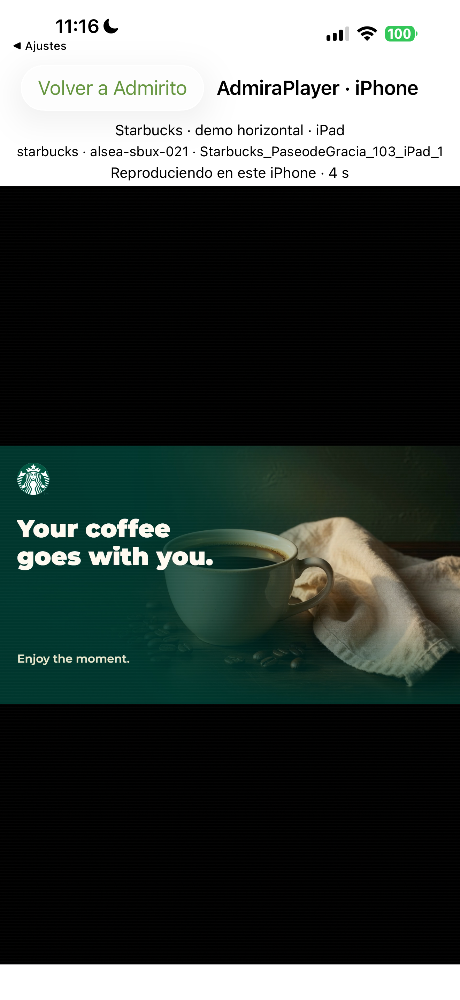

# AdmiraPlayer en el propio iPhone / On-device iPhone player

## Español

En Admirito → AdmiraNeXT → modo Experto, «Player en este iPhone» permite elegir proyecto, local y dispositivo IoT del catálogo público de Admira. «Reproducir en este iPhone» comprueba su playlist asignada y abre el reproductor web canónico de Admira.tv dentro de la aplicación. También admite `/player PROYECTO LOCAL ID_IOT`; la combinación debe existir exactamente en el catálogo.

Ejemplo de lectura de la playlist pública del iPad de referencia: `/player starbucks alsea-sbux-021 Starbucks_PaseodeGracia_103_iPad_1`. Esto reproduce sus contenidos en el iPhone; no es observación del iPad físico ni cambia su emisión.

Se conserva la asociación real `idIoT → player`, o `instance`, o `surfaces.screen`. Starbucks aplica el mismo prefijo exacto `alsea-sbux-` que Biz; otros proyectos requieren `project_id` o `projects[]` explícitos. El catálogo no adivina relaciones por nombres comerciales y muestra locales sin IoT, pero no permite arrancarlos. Las asociaciones faltantes deben corregirse en el inventario maestro. Esta selección de contenido público no concede acceso a `/proyecto`, inventarios privados ni control remoto.

Cada instalación tiene una identidad virtual propia y un almacén web efímero. Solo la lectura de `/api/playlist` se dirige al origen seleccionado; circuit, machine, colas y controles no adoptan la identidad del IoT físico. Una playlist vacía o no reproducible muestra un error antes de abrir el player; no se sustituye por Stock general. Se conserva la última playlist confirmada ante errores posteriores de consulta. Los vídeos arrancan silenciados, igual que en el Fold. La comprobación realizada aquí es de vídeo; no acredita audio audible.

«Volver a Admirito» detiene y libera el reproductor. Al salir de la app se pausa y se restaura el reposo de pantalla; volver no dispara reproducción automática. Admirito suspende el micrófono de activación y sus respuestas de voz mientras el player está abierto. iOS limita la ejecución en segundo plano.

## English

Admirito → AdmiraNeXT → Expert → “Player en este iPhone” selects an explicit project, location and IoT from the public inventory. The same `/player PROJECT LOCATION IOT_ID` command validates the exact association before opening the canonical Admira.tv renderer on this iPhone. The selected device remains the playlist source; a persistent virtual identity and ephemeral website storage keep the iPhone separate from its source's playback, telemetry and remote controls. Public content selection grants no project authorization or private inventory access.

Empty or unplayable assignments fail visibly. Missing inventory associations are not guessed from names. Video starts muted. Returning closes the renderer; backgrounding pauses playback, and returning does not automatically resume. Wake-word capture and assistant speech remain suspended while the player is open.

## Verification

- iOS release 20261018.5, build 30 installed on the physical iPhone. Android's public APK remains 20261018.3; this is an iPhone-only feature.
- Three native validation tests passed: command parsing/injection rejection, exact project/IoT membership and source preference, and empty/unsafe media rejection.
- The Expert command opened the real assigned two-video Starbucks iPad playlist; native playback time advanced from 0 to 5 seconds. Full-device screenshots reviewed; return to Expert and reopening without stale selection passed.
- Manual selection of project, local and IoT passed on the physical device, followed by actual video playback. The IoT uses a native navigation list so long device identifiers do not overflow a menu. Returning from that list retains the loaded catalogue.
- A real empty assignment was rejected before opening playback. Native pause and explicit resume were observed after switching to Settings; the player then showed advancing video. Final combined acceptance passed; playback was left visible on the iPhone at 4 seconds after explicit resume.
- The automated Home button did not reliably leave the app, and XCTest's application-state indicator remained stale during an explicit application switch. Acceptance uses the actual native pause control, its paused status and subsequent video playback rather than that indicator.
- Video starts muted. No audible-audio acceptance is claimed.

Mission FLT-102549 · reproductor configurable en iPhone; encargo #6480 · player desde Experto del iPhone. The source iPad's playlist is used read-only; no physical source-display behavior is inferred. [Sanitized evidence](evidence/admirito-iphone-player-2026-10-18/verification.json).

