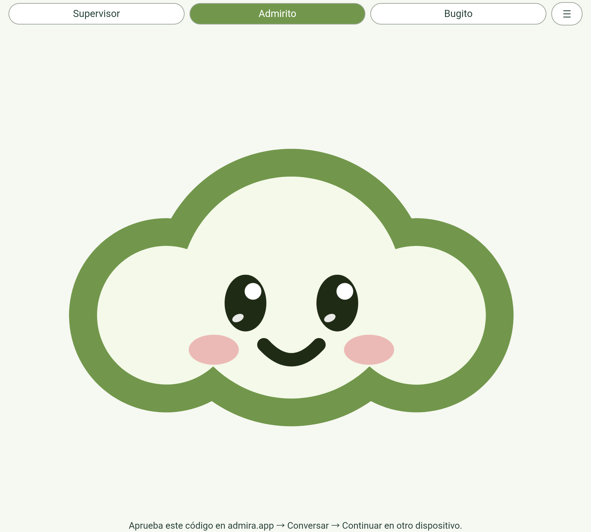

# Admirito Android · primera instalación en Samsung Fold · 17 octubre 2026

Entrada canónica: https://www.admira.app/admirito. Descarga firmada de pruebas: https://www.admira.app/downloads/admirito-android-0.1.0.apk.

- Release compilada y análisis Android lint correctos. Firma APK v2 verificada.
- Instalación real por USB: Success. Aplicación abierta y mascota grande observada en la pantalla interior; captura adjunta.
- Prueba instrumentada de mascotas y viewport superada primero en estado abierto y después en estado cerrado emulado por Android. La prueba comprueba las tres SVG cargadas, selección visual, ausencia de desbordamiento horizontal, tamaño del escenario y transformación de mirada. El registro conservado de pantalla exterior tiene OK (1 test).
- No equivale a una prueba de plegado físico: se utilizó el control de estado de desarrollo del dispositivo y después se restableció. Las capturas por defecto de Samsung pueden devolver un panel inactivo; no se usan como evidencia de la pantalla visible.
- 26 pruebas de conversación, vinculación Android y canales de agente superadas. 11 comprobaciones de gramática nativa. 70 pruebas del marco web y publicación superadas.
- Las credenciales no se han extraído ni incorporado al APK. La cuenta Android queda pendiente de aprobación por Carlos. El código inicial caduca a los cinco minutos.
- El dispositivo dejó de estar disponible por USB antes de ejecutar la ampliación del test de ambas orientaciones. Quedan pendientes giro físico, órdenes acústicas, conversación sincronizada autenticada y escucha bloqueada con resumen real. No se afirma paridad completa con iOS; ver README Android para límites de esta primera versión.

