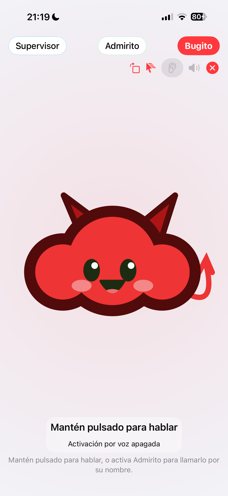
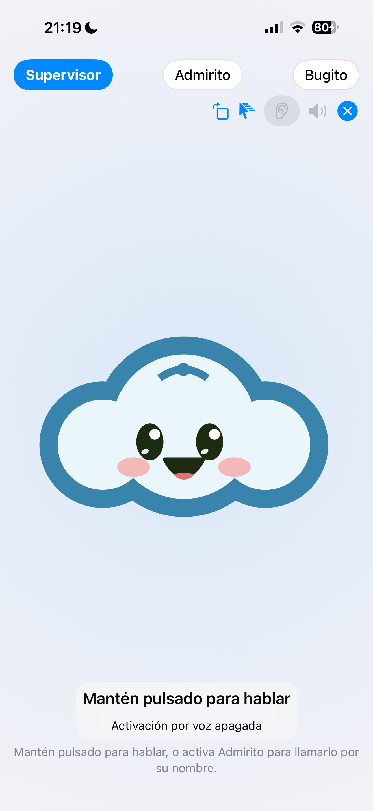
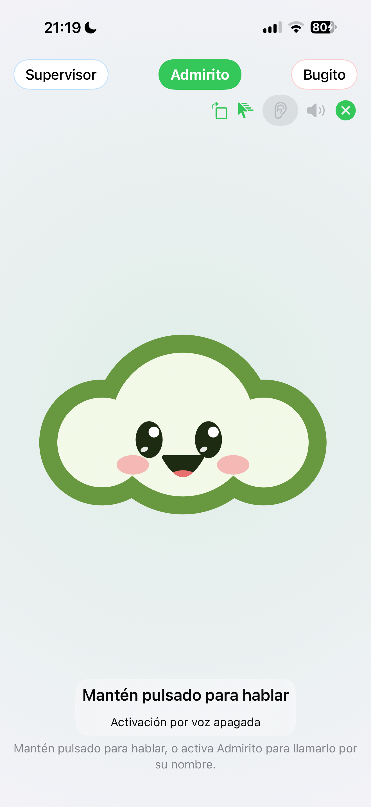

# Admirito · selector, tamaño y prueba IoT por voz

17-oct-2026 · OraculoMacMini · iOS build 19.

## Vista

Quitado el segundo título del personaje y el aviso de cambio que repetía su nombre. La pestaña activa lleva el color de Admirito (verde), Bugito (rojo) o Supervisor (azul), también comunicado a accesibilidad. Escenario de mascota a tamaño completo detrás de los controles, sin restarle las dos filas y el estado inferior. Las tres conservan el mismo espacio, mirada y gesto de mantener pulsado.

Prueba física USB de las tres mascotas en vertical y horizontal: seleccionada correcta, sin título duplicado, área de gesto mayor que el 80 % de la altura y todos los controles dentro de pantalla. Pasa. Carlos confirmó en el turno anterior el giro físico en ambos sentidos. La última compilación elimina también el texto de cambio del estado inferior. Dos comprobaciones finales en el iPhone, cero fallos; app normal restaurada en horizontal. La recuperación por voz y su confirmación hablada pasan como caso separado.

## Prueba acústica y resultado real

Frases reproducidas por los altavoces del Mac y captadas por el micrófono del iPhone, sincronizadas con command_ready; los comandos no se inyectan como texto. XCTest mantiene pulsada la mascota y suelta. Los dos canales los opera el agente real Oráculo mediante el buzón, no agentes autónomos nuevos.

- Encargo #6426 · invocación acústica correcta de Bugito. Respuesta real devuelta al iPhone y final de voz observado.
- Encargo #6427 · pausa del player MBP16 dictada correctamente. Orden real por la cola canónica /locations/cmd y acuse executed; playlist y audio intactos.
- Encargo #6428 · primera invocación de Supervisor deformada por el dictado. Se respondió error sin adivinar la petición ni ejecutar acciones.
- Encargo #6429 · invocación de Supervisor reconocida al repetir con otra voz. Detectó que el acuse de pausa no bastaba: la telemetría volvió a cambiar de pieza antes de play. La pausa persistente falla.
- Encargo #6430 · orden acústica a Supervisor de identificar playlist y recuperar. Play real con acuse executed y avance posterior a «El paseo también se saborea». Playlist Starbucks 180 · MacBookPro16, 20 piezas y revisión conservada. Audio silenciado, sin afirmar sonido audible.

La secuencia completa NO se califica como pasada: requirió repetir una invocación y la pausa no permaneció estable. El caso separado de recuperación comprueba respuesta y final de voz. Hubo reinicios del harness de pruebas; no se presenta como una ejecución única sin interrupciones.

El monitor existente macmini-insta360 tiene una imagen del MBP16 antigua y estado sin-dato. No se usa como prueba óptica actual ni se atribuye su incidencia previa a esta prueba. No se creó un ticket ficticio ni se inició otro monitor. La evidencia de emisión es comunicada por el player, no confirmación física por cámara.

Datos mínimos de acuses y evolución: [player-proof.json](player-proof.json).

## English

Full-stage mascots, one name per tab, selected tab highlighted in its character color with accessible selection state. Device layout test passes for all three in both orientations. Actual loudspeaker-to-iPhone speech reached the real agent mailbox. Bugito pause was acknowledged, but subsequent telemetry advanced before recovery, so persistent pause FAILED. Supervisor invocation needed a retry. The subsequent spoken recovery sent play, received executed and observed a later item start. Playlist unchanged, audio muted. Existing optical evidence is stale. This is not a clean uninterrupted end-to-end pass.

