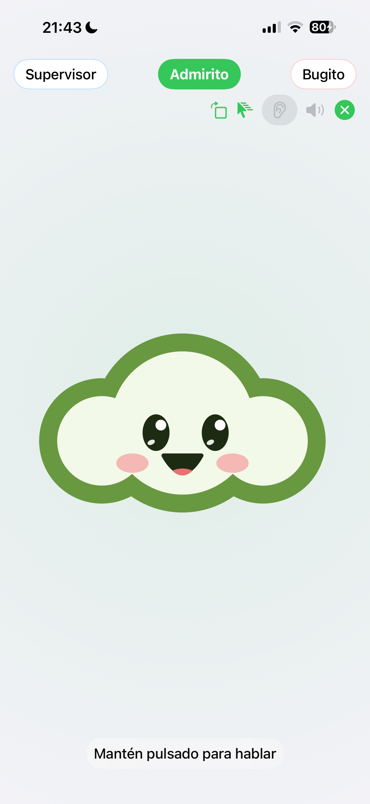
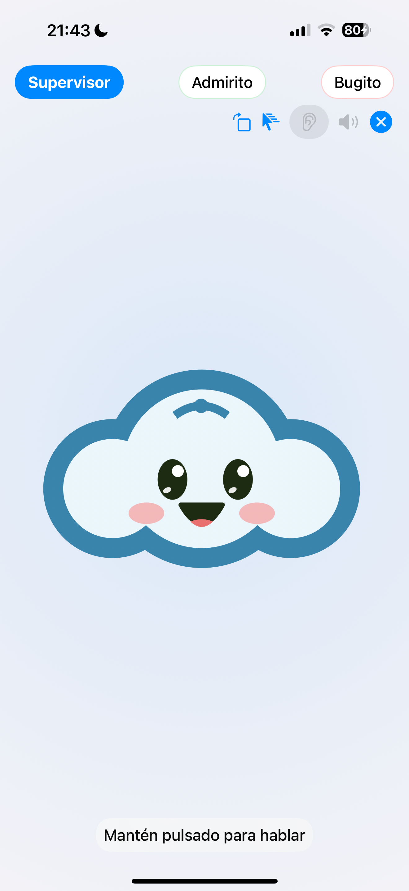

# Admirito · pausa persistente y cartela de una línea

17-oct-2026 · OraculoMacMini · iOS build 21.

## Cambios publicados

- Admira.tv v.17.10.2026.r1.21:27, commit 10077826 · pausa real y persistente. La cola /locations/cmd enviaba pause/play a runCli, que no los implementaba, y devolvía executed sin modificar la reproducción. Ahora usa el dispatcher real y propaga el resultado, incluido un fallo de play.
- La intención de pausa se guarda por pantalla. Temporizadores, avances por ended/error, metadatos tardíos, recuperación de códec y reconstrucciones de playlist respetan esa pausa. Se reanuda con una orden explícita. Las pruebas cubren restauración del estado al recargar; no se hizo un reinicio físico del Mac durante la pausa.
- iOS: una sola línea de estado, sin la segunda leyenda de activación ni el párrafo inferior repetido. Conserva las mascotas grandes y la pestaña activa coloreada. El estado de escucha sigue accesible desde el botón y su ayuda de accesibilidad.
- La prueba larga descubrió que el iPhone dejaba de consultar al agente a los 90 s. Build 21 espera hasta diez minutos y consulta respuestas pendientes al volver a la app, sin volver a enviar la acción al agente.

## Prueba acústica en el iPhone

Órdenes reproducidas por altavoces del Mac y captadas por el micrófono del iPhone. XCTest mantiene pulsada la mascota y suelta; ningún texto de comando se inyecta en el teléfono. Los canales Bugito y Supervisor los opera Oráculo mediante el buzón real.

La secuencia completa de build 21 pasa en un único caso XCTest, con confirmación hablada final de cada fase:

- Encargo #6434 · invocación acústica de Bugito.
- Encargo #6435 · pausa del MacBook Pro 16. Orden idempotente sobre una pausa ya activa del primer pase; no se intercaló play para reiniciar la prueba. La respuesta se recibió tras más de 90 s, verificando también la espera corregida del iPhone.
- Encargo #6436 · invocación acústica de Supervisor, que identificó Starbucks 180 · MacBookPro16, 20 piezas, y esperó la orden de recuperación.
- Encargo #6437 · recuperación dictada a Supervisor. Primera orden play desde la pausa corregida, acuse executed y nuevo pase comunicado: «Volvemos a empezar».

El primer pase había aplicado pause desde reproducción. La primera pausa y el play de Supervisor están separados por 695 s; hubo un reinicio del harness entre esos momentos para instalar la corrección de espera de iOS. No se presenta ese intervalo como una observación óptica continua. Durante la espera se observaron muestras sin avance y dos capturas nuevas del player, confirmadas por acuses de captura separados por 93 s, con exactamente el mismo JPEG. Son capturas de la media del player; no fotos ópticas del panel.

La consulta pública /signage/now dejó de refrescar su fecha y acabó devolviendo item:null durante la pausa larga. Los monitores iniciales fallaron al exigir frescura o confundir null con cambio de pieza; se conserva esa transición en proof.json. No se observó una pieza nueva antes del play. La presencia en registro y los acuses reales del player se consultaron por separado; las capturas posteriores cuyo comando devolvió failed no se consideran nuevas. Supervisor informó de esa caducidad, sin inventar una señal reciente. Tras play volvió una emisión nueva y fechada.

Playlist y revisión conservadas, audio silenciado. No se provocó un fallo físico de panel ni se creó un ticket ficticio. La app queda en modo normal al finalizar.

## Validación

22 pruebas específicas de control, pausa y códec pasan. Suite canal: 143 de 144; la única falla, una aserción de texto antigua de sincro en canal-eficiencia.test.mjs, también falla en HEAD sin esta modificación (baseline 10/11). Nativas: 23 pruebas, 2 omitidas, cero fallos. Prueba acústica completa build 21: pasa; el primer pase build 20 falló por el límite de espera de 90 s y motivó su corrección. Dos comprobaciones finales del diseño en el iPhone pasan, en ambas orientaciones, con cartela menor de 40 pt de altura y sin segunda leyenda. La prueba acústica completa dura 446,9 s y finaliza con cero fallos. App normal restaurada en horizontal.

[Datos mínimos de la prueba](proof.json).

## English

The legacy command queue previously acknowledged unimplemented CLI pause/play commands. It now dispatches real playback controls. Persisted per-screen pause intent blocks automatic recovery/advance until explicit resume. iOS shows a single-line status and polls long-running agent tasks for up to ten minutes, resuming GET checks on app activation without re-sending the action. The final four-step acoustic iPhone test passes with spoken completion for every phase. A first real pause was retained across the harness update; repeated pause is idempotent. Identical player captures 93 seconds apart establish a held frame. The public emission snapshot expired during the long pause; expired data and failed captures are not treated as fresh evidence. Supervisor play was followed by a newly dated emitted item. This is software/player evidence, not continuous optical panel observation.

