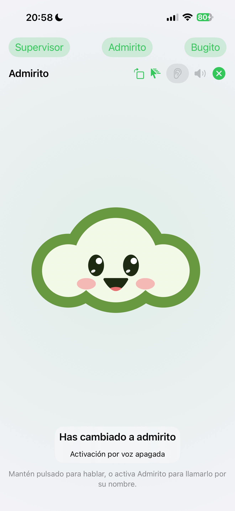
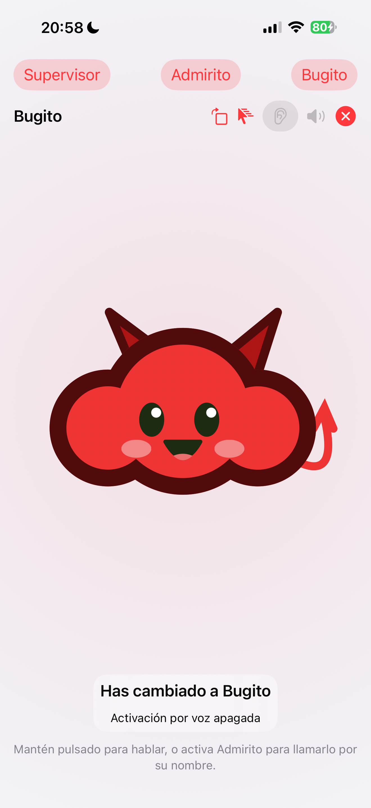
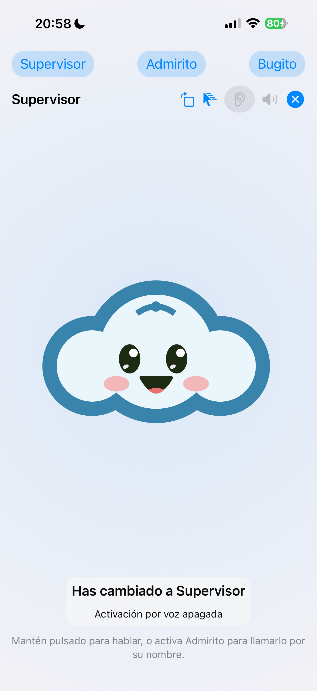

# Admirito · tres mascotas y giro / Three mascots and rotation

17-oct-2026 · OraculoMacMini · iOS build 18.

Botones permanentes Supervisor / Admirito / Bugito. Los tres sustituyen el personaje en el mismo escenario; volver a Admirito ya no exige salir. Se conserva la mirada y el tamaño del área. El dibujo web usa el tamaño del contenedor y se reconstruye al cambiar de orientación.

Prueba real por USB: tres cambios en horizontal y tres en vertical, mismo marco del escenario en cada orientación, botón Girar en ambos sentidos. Una prueba física automatizada, cero fallos (18,3 s). 23 pruebas nativas: 2 omitidas, cero fallos. La cámara corrobora el personaje visible. Bloqueo de rotación de iOS desactivado; el teléfono está casi plano sobre la mesa. El giro físico por sensor sigue pendiente de que Carlos lo levante y lo gire; el botón permite cambiarlo incluso en esa posición.

Permanent Supervisor / Admirito / Bugito buttons replace the character in the same stage. Real USB test covers all three in portrait and landscape, identical stage frames within each orientation, and the Rotate button in both directions. Natural sensor rotation still requires a physical tilt test. No IoT fault or playlist change was triggered by selecting a mascot.

Las capturas horizontales de XCTest salieron recortadas con franjas negras y no se usan como prueba visual. El encaje horizontal se corroboró por la cámara y por los marcos accesibles de los botones. Landscape XCTest image exports were malformed; they are excluded from visual evidence.
