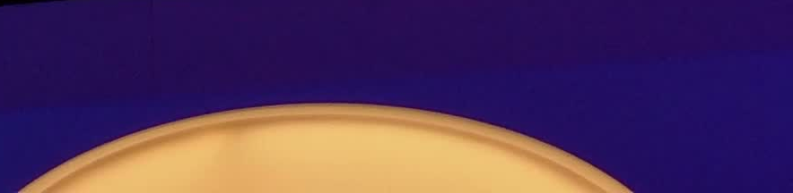
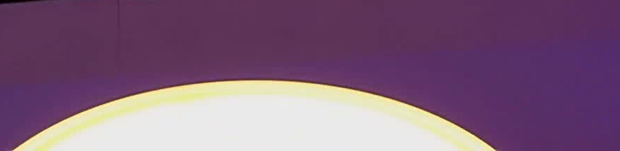
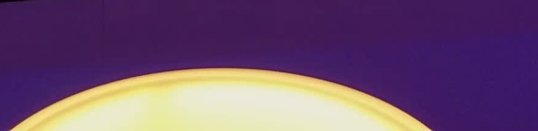
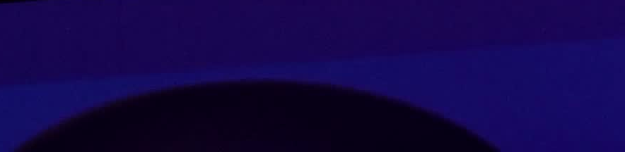

# Iluminación reactiva del Lab / Reactive Lab lighting

18 octubre 2026 · OraculoMacMini · misión FLT-102542 · iluminación reactiva del Lab.

Ámbito fijo: plafón del techo del AdmiraNeXT Lab, Gran de Gràcia primera planta. Identificado con Insta360: Hue light 9 «Lampara Despacho», Hue Amaze Pendant 4023331P6; blancos y brillo, sin RGB. Evidencia inicial: https://github.com/csilvasantin/admirabot/blob/master/LAB-HUE.md.

| Evento real / Actual event | Intensidad actual / Current intensity | RGB futuro / Future RGB |
| --- | ---: | --- |
| Normal, sin incidencias / Normal, no incidents | 100 % | Blanco / White |
| Incidencia abierta / Incident opened | Apagada / Off | Amarillo / Yellow |
| Bugito invocado / Bugito invoked | 25 % | Rojo / Red |
| Supervisor invocado / Supervisor invoked | 75 % | Verde / Green |
| Admirito invocado / Admirito invoked | 50 % | Blanco / White |
| Última incidencia cerrada / Last incident closed | 100 % | Blanco / White |

El último evento confirmado manda: una nueva incidencia apaga; una invocación posterior aplica su nivel; cerrar la última devuelve normal. Cerrar una incidencia con otra todavía abierta mantiene apagado/amarillo. Cerrar la mascota vuelve a normal si no hay incidencias. No se infiere recuperación a partir de la luz. La fotografía de cámara es una prueba separada del ACK y de la lectura de Hue.

## Circuito

- `POST /agents/lab-lighting {mascot,request_id}`: selección normal/admirito/bugito/supervisor, autorizada en servidor exclusivamente a las dos cuentas de Carlos y al operador de silicio. Los móviles deben estar vinculados a Carlos con ámbito Admirito iOS/Android. Otros usuarios, gafas y orígenes quedan rechazados. No acepta intensidad, destino, incidencias ni cierres arbitrarios del cliente.
- `GET /agents/lab-lighting`: estado deseado. Las incidencias proceden de `tickets`, solo recursos `supervisor:gran-de-gracia:*`, `supervisor:admirito-fold:*` y `virtual-lab-admirito-fold`. No se alteran sus estados ni los requisitos de recuperación óptica.
- Admirito iOS emite cambios al abrir/cerrar la mascota y seleccionar/invocar Bugito, Supervisor o Admirito. La web conecta el selector de `/conversar` y la entrada `/supervisor`. Android conserva su versión anterior; no se afirma conexión nativa de iluminación en ese cliente.
- El actuador local `scripts/lab-hue-controller.py` consulta cada tres segundos mediante la entrada oficial de agentes. Solo escribe los IDs explícitos de la bóveda. Bloqueo de proceso impide dos actuadores. Comprueba alcance y capacidades antes de enviar y relee encendido/brillo/blanco tras cada cambio. Un error de origen, sesión o Hue conserva el último estado físico y registra fallo; no declara verificación óptica.
- El controlador no inicia, mueve ni captura una cámara. La comprobación visual usa el único productor Insta360 del Supervisor existente.

## Bóveda, instalación y reversión

`ADMIRANEXT_LAB_HUE_CONFIG` conserva identidad del puente, credencial, objetivo, estado de referencia, modo activo, estado RGB pendiente y mapas completos. `ADMIRABOT_HUE_API` conserva compatibilidad con la app de Telegram anterior. `ADMIRANEXT_LAB_HUE_AUTOMATION` registra fuente, contrato, instalación, versión, pruebas y pendientes. Nunca publicar los valores de estas entradas.

Instalador reproducible: `python3 scripts/install-lab-hue.py`. El proceso utiliza prioridad Interactive para responder a eventos sin abrir ventanas ni tomar foco; Background produjo retrasos en este Mac.

Instalación local: copia verificable del actuador en `~/agent-tools/lab-hue/lab-hue-controller.py`; servicio `com.admira.lab-hue`, sin claves en el plist; logs y lectura física más reciente en `~/.config/admiranext/lab-hue/`. La clave se recupera de la bóveda al arrancar. Al cambiar configuración hay que reiniciar este servicio. El modo activo es `intensity`.

Para parar: retirar únicamente `com.admira.lab-hue` de launchctl; restaurar el objetivo a `baseline` desde la bóveda. No reiniciar Supervisor ni cámara y no alterar otros puentes o luces. La automatización no se usa para volver a encender tras una orden manual sin un nuevo evento; al reiniciar se aplica el estado canónico más reciente.

Para RGB: instalar/vincular una luminaria de techo RGB, comprobar por cámara e identificar su ID exacto y capacidades; guardar el nuevo destino en bóveda, conservar referencia blanca, cambiar `mode` a `rgb` y reiniciar el actuador. Ejecutar rojo/amarillo/verde/blanco y comprobar ópticamente. El modo RGB está implementado pero pendiente de hardware y prueba física; no se activa sobre la actual Amaze.

## English

Only the fixed Lab ceiling is controlled. The current white-only pendant uses intensity; future RGB is implemented but remains disabled pending a colour-capable ceiling target and optical verification. Actual canonical Lab tickets and authenticated mascot selections determine the desired state. Last event wins, while closing one incident cannot restore normal if another is open. Local actuator reads credentials/configuration from the fleet vault, enforces explicit target IDs and capabilities, serializes changes, validates Hue responses and readback, and never treats acknowledgement as optical proof. Native Android lighting has not been updated in this release.

## Verificación publicada · 18 octubre

- API: `v.18.10.2026.r1.09:15`, worker `5ebf7414-25f3-47c5-adf4-ff75b8aa7867` · control de iluminación autorizado. Web: `v.18.10.2026.r2.09:18`, sello limpio confirmado. iPhone: instalada versión `20261018.1`, build 26.
- Servidor: 1407 pruebas correctas, una omitida; web: 1673 correctas; actuador: tres pruebas de porcentajes, rechazo RGB y ausencia de escrituras sobre destino inalcanzable.
- Navegador público autenticado por la entrada oficial: selección real de Bugito 25, Supervisor 75 y Admirito 50; cero errores de página. Actuador permanente: aplicación y lectura de retorno en 4,7 / 3,8 / 3,6 segundos. Volver a normal: apagada en 3,6 segundos porque el Lab mantiene dos incidencias canónicas abiertas. No se modificaron ni cerraron para fabricar una prueba.
- Secuencia óptica revisada: los cuatro recortes siguientes son fotos recientes del plafón con la Insta360 existente. Hue confirma los porcentajes; la cámara confirma los cambios visibles, sin convertir luminancia automática en medida absoluta de porcentaje.

| Bugito 25 % | Supervisor 75 % | Admirito 50 % | Incidencia apagada |
| --- | --- | --- | --- |
|  |  |  |  |

Las marcas de hora y las lecturas se conservan en [observaciones saneadas](evidence/lab-hue-2026-10-18/observations.json). La referencia al 100 % y la identificación por atenuación/restauración están en la evidencia inicial de AdmiraBot enlazada arriba. Se restauraron posición de cámara y ejecución del detector tras la verificación. No se inició otro productor de cámara.

La compilación y la instalación iPhone se completaron. El intento de prueba de botones con XCTest no pudo activar el modo de automatización de iOS (`Timed out while enabling automation mode`). No se presenta ese intento como prueba física nativa completada. Queda pendiente su aceptación desde los botones del iPhone. RGB y Android nativo conservan los límites indicados anteriormente.

English: web selections, authenticated event propagation, bridge readback and four current optical captures passed. iOS was built and installed; XCTest could not enable iOS automation mode, so native button acceptance remains pending. RGB ceiling hardware and optical RGB validation remain pending.
